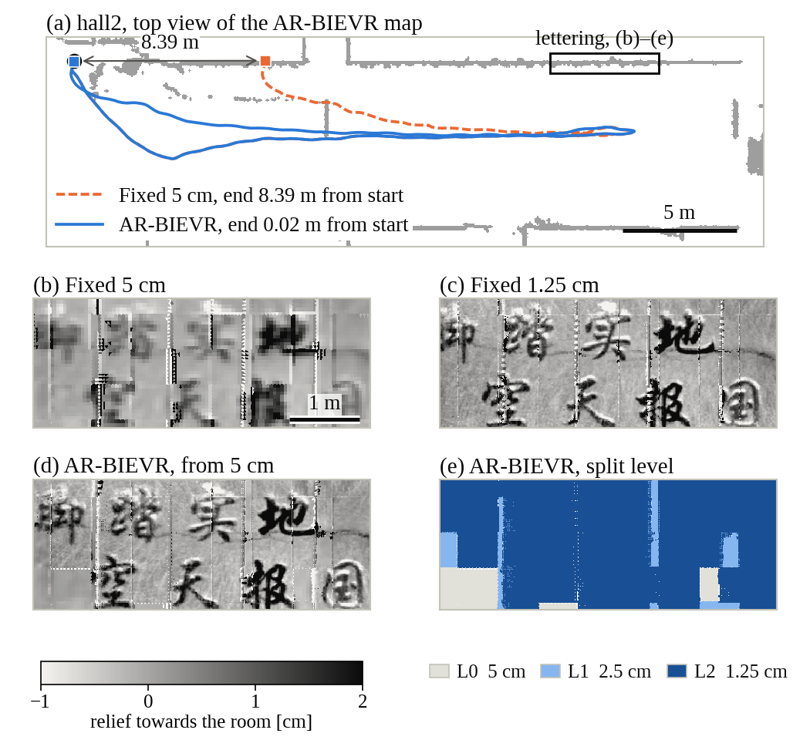

# AR-BIEVR

Code for *Adaptive-Resolution Bump-Image Voxel Maps for Robust LiDAR-Inertial Odometry*. The source code will be released upon acceptance.

  

AR-BIEVR refines the height image only where the observations contain structure that the current pixels cannot represent.
(a) On hall2, BIEVR-LIO with fixed 5 cm pixels slips along the hall and ends 8.39 m from its start; AR-BIEVR, starting from the same pixel size, returns to within 0.02 m.
(b)–(e) The wall lettering just before the fixed 5 cm run starts to slip: fixed 5 cm pixels average it into blobs, while AR-BIEVR resolves it as clearly as uniform 1.25 cm pixels by splitting only the voxels that contain it.
